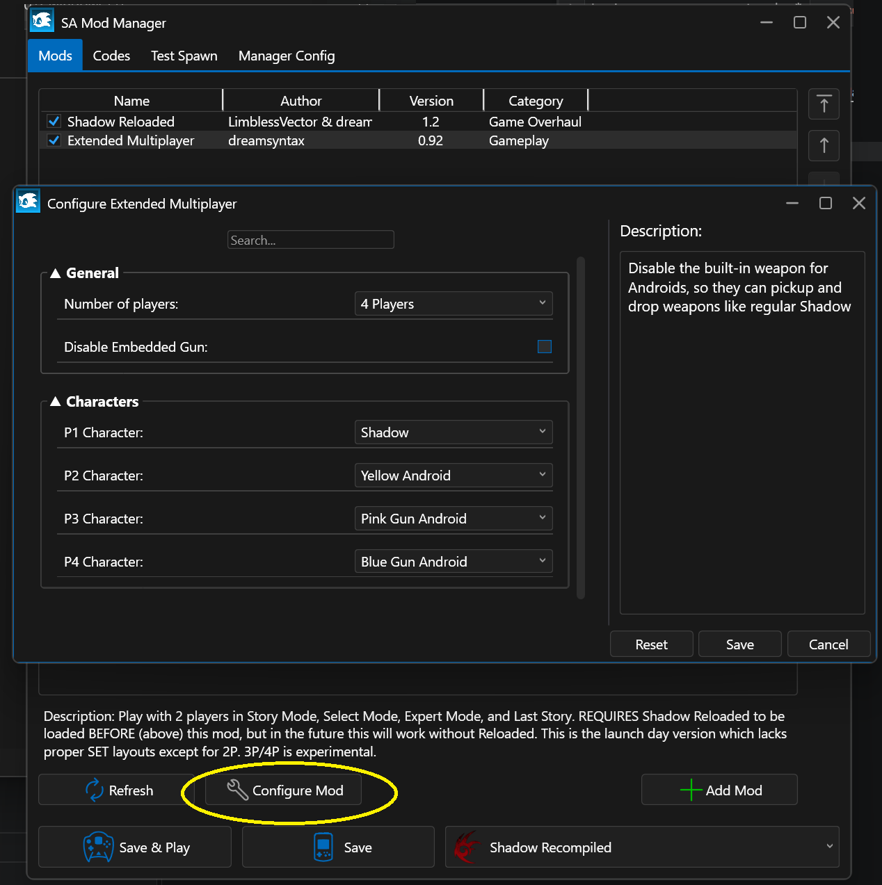

## How do I use it?

1. Add the mod directly to [SAMM](https://github.com/X-Hax/SA-Mod-Manager)
2. Currently requires [Shadow Reloaded](https://github.com/ShadowTheHedgehogHacking/ShadowRecompReloaded) as a dependency
3. Ensure 'Extended Multiplayer' is **BELOW** Shadow Reloaded
4. Play! (2P by default, otherwise Configure Mod)

## How do I use the experimental 3P/4P?

Note that 3P/4P object layouts have not been created, coming soon (tm)

Pick "Configure Mod"

